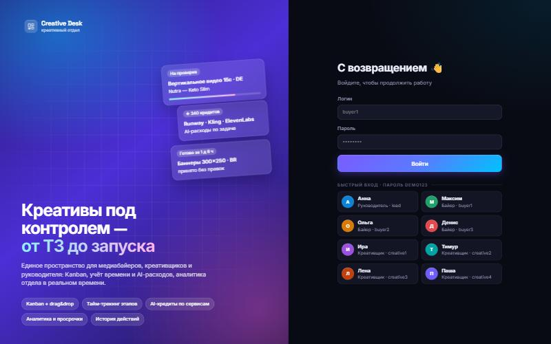
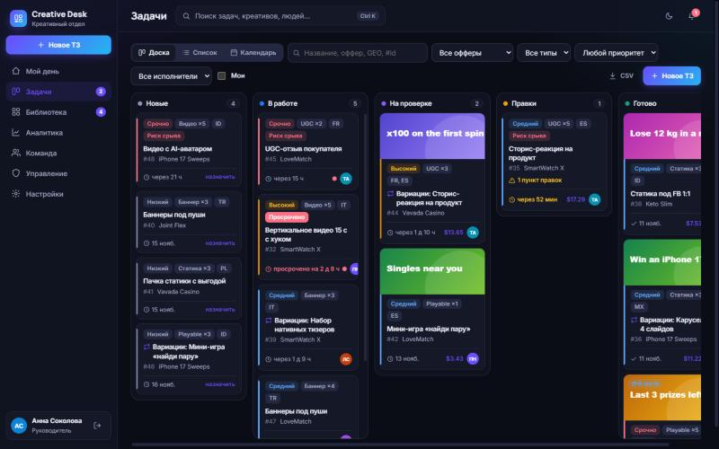
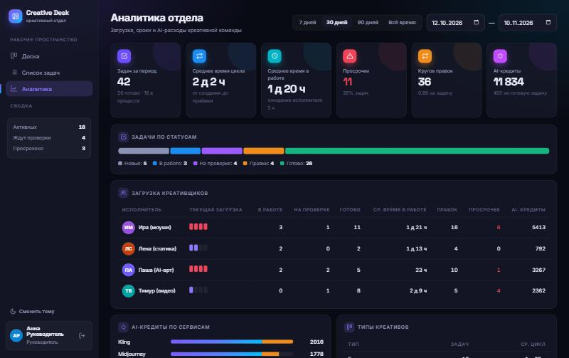
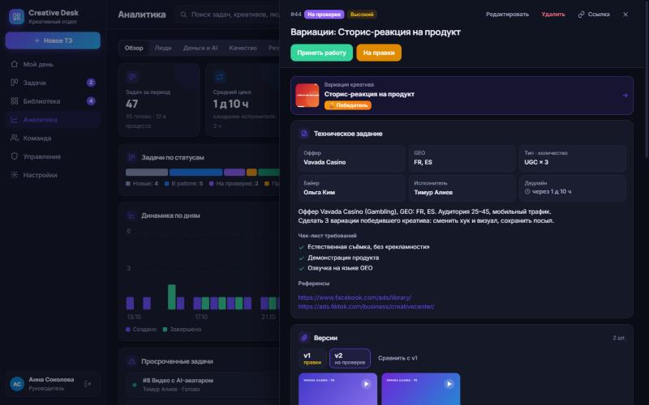
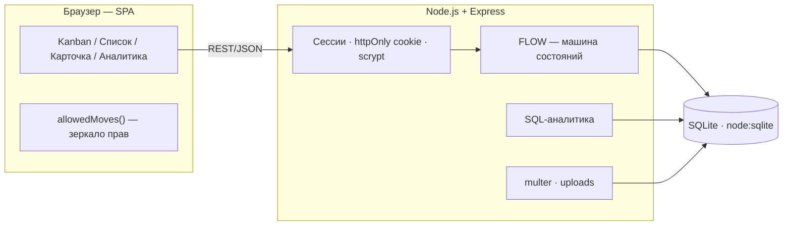
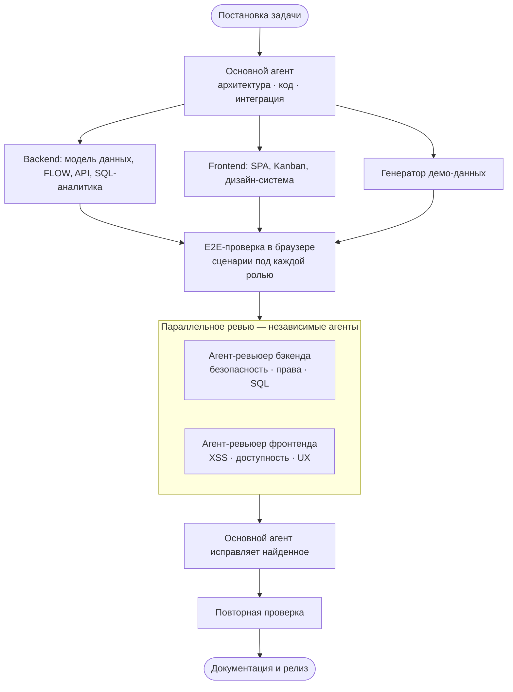

<div align="center">

# ✦ Creative Desk

**Сервис для работы креативного отдела: медиабайер ставит ТЗ, креативщик его выполняет, руководитель видит всю картину.**

Kanban · учёт времени по этапам · учёт AI-расходов · аналитика отдела · полная история действий

`Node.js 22` · `Express` · `SQLite` · `Vanilla JS SPA` · `Docker` · `Render`

### 🚀 [Открыть демо → creative-desk-3m61.onrender.com](https://creative-desk-3m61.onrender.com)

Пароль у всех демо-пользователей: `demo123` · первое открытие после простоя занимает до минуты

</div>

<p align="center"> <br> </p>

---

## Что умеет

### Для медиабайера
- **Форма ТЗ**: оффер, GEO, тип креатива, количество, описание, референсы, приоритет и дедлайн. Каждое поле проверяется и на клиенте, и на сервере.
- **Приёмка работы.** Байер принимает результат или отправляет его на правки. Без комментария на правки не отправить: исполнитель всегда знает, что именно поправить.
- **Переоткрытие.** Принятую задачу можно вернуть в правки. Круг правок засчитывается, время пересчитывается.

### Для креативщика
- **Самостоятельный выбор задач.** Колонка «Новые» служит общей очередью. Взятая задача закрепляется за исполнителем, и другой креативщик её уже не возьмёт.
- **Сдача результата.** Можно приложить файлы (до 10 шт. по 25 МБ) и/или ссылки на Drive или Figma, добавить комментарий. Каждая сдача хранится отдельной версией: первая сдача, правки 1, правки 2…
- **AI-расходы.** При сдаче указываются сервисы и потраченные кредиты, отдельной кнопкой их можно внести и в процессе работы. Расходы на правки считаются отдельно.

### Для руководителя
- **Дашборд** за период: 7 дней, 30 дней, 90 дней, всё время или свой диапазон.
- **KPI**: число задач, среднее время цикла, среднее время в работе, время ожидания исполнителя, просрочки, круги правок, AI-кредиты (всего и на одну готовую задачу).
- **Загрузка креативщиков**: шкала текущей загрузки с подсветкой перегруза, а также готовые задачи, среднее время, правки, просрочки и кредиты по каждому.
- **AI-аналитика**: расходы по сервисам (основная работа и правки отдельно) и тепловая матрица «исполнитель × сервис».
- **Отдельные блоки**: список просрочек с величиной опоздания, статистика по байерам и типам креативов, лента всех действий в отделе.

### Общее
- **Kanban на 5 колонок**: Новые → В работе → На проверке → Правки → Готово. Карточки перетаскиваются мышкой (drag-and-drop), при этом подсвечиваются только колонки, куда этой роли можно перенести задачу.
- **Учёт времени** без ручного ввода: система сама фиксирует создание, взятие в работу, первую и последнюю сдачу и приёмку. Из этих отметок считаются 4 метрики длительности.
- **Журнал**: каждое действие (кто, когда, из какого статуса в какой, с каким комментарием) попадает в неизменяемую таблицу `history`.
- **Интерфейс**: светлая и тёмная тема, адаптивная вёрстка (на телефоне колонки доски листаются свайпом), управление с клавиатуры, учёт системной настройки `prefers-reduced-motion`.

### Дополнительно
- **Центр уведомлений** (колокольчик): события по вашим задачам с индикатором непрочитанных. Типы событий включаются в настройках.
- **Командная палитра** ( или ): быстрый поиск задач и переходы по разделам с клавиатуры.
- **Назначение исполнителя**: руководитель перетаскивает свободную карточку в «В работе», и система предлагает наименее загруженного креативщика.
- **Страница «Команда»**: состав отдела, специализации и загрузка каждого.
- **Настройки**: тема, плотность карточек, акцентный цвет, уведомления, стоимость кредита (по ней в аналитике считается бюджет в $), параметры рабочего пространства.
- **График по дням** в аналитике: сколько задач создано и завершено.
- **Если перенос карточки невозможен**, интерфейс объясняет причину.

> Раздел интеграций (Telegram, Slack, Drive, Notion), SLA, автоназначение и email-дайджест работают в **демо-режиме**: настройки сохраняются в браузере, но внешние сервисы не подключаются.

## Демо-доступ

Пароль у всех: **`demo123`**. На странице входа есть кнопки быстрого входа под каждым пользователем.

| Логин | Роль | Что посмотреть |
|---|---|---|
| `lead` | Руководитель | Аналитика, лента действий, просрочки |
| `buyer1` · `buyer2` · `buyer3` | Медиабайеры | Создание ТЗ, приёмка, отправка на правки |
| `creative1` … `creative4` | Креативщики | Взять задачу, сдать результат, указать AI-кредиты |

Демо-данные создаются при первом запуске: 42 задачи за последние 30 дней. Это не «нарисованные» записи. Генератор прогоняет каждую задачу через тот же жизненный цикл, что и живой пользователь: взятие, сдачи, правки, приёмка. Поэтому история, время по этапам и AI-расходы между собой согласованы. Креативщики работают с разной скоростью, чтобы в аналитике было что сравнивать.

## Архитектура



**Машина состояний.** Все переходы описаны в одном месте, в объекте `FLOW` в [`server.js`](server.js). Права проверяет сервер на каждом запросе. Клиент повторяет те же правила только для подсказок в интерфейсе.

| Действие | Откуда → куда | Кто |
|---|---|---|
| `take` | Новые → В работе | креативщик |
| `submit` | В работе / Правки → На проверке | исполнитель задачи |
| `revise` | На проверке → Правки *(комментарий обязателен)* | автор ТЗ / руководитель |
| `accept` | На проверке → Готово | автор ТЗ / руководитель |
| `release` | В работе → Новые | исполнитель / руководитель |
| `reopen` | Готово → Правки | автор ТЗ / руководитель |

**Модель данных:** `users` · `sessions` · `tasks` (отметки времени по этапам и счётчик правок) · `results` (версии сдач) · `ai_costs` (сервис, кредиты, номер круга) · `history` (журнал).

**Почему такой стек.** `node:sqlite` встроен в Node 22, поэтому нет нативных зависимостей и сборки: проект разворачивается одной командой где угодно. Фронтенд тоже работает без сборщика. Весь сервис занимает ~1400 строк кода, который легко прочитать целиком.

## Запуск

```bash
npm install
npm start          # → http://localhost:3000
npm run reset      # пересоздать демо-данные (при остановленном сервере)
SEED_DEMO=0 npm start   # запуск без демо-аккаунтов
```

**Docker:**
```bash
docker build -t creative-desk . && docker run -p 3000:3000 creative-desk
```

**Render:** New → Blueprint → этот репозиторий. Настройки уже лежат в [`render.yaml`](render.yaml). На бесплатном плане диск временный, поэтому после перезапуска демо-данные создаются заново.

## API

| Метод | Путь | Описание |
|---|---|---|
| `POST` | `/api/login`, `/api/logout` | Вход и выход |
| `GET` | `/api/me`, `/api/users` | Текущий пользователь, справочник пользователей |
| `GET / POST` | `/api/tasks` | Список с фильтрами, создание ТЗ |
| `GET / PATCH / DELETE` | `/api/tasks/:id` | Карточка задачи (с результатами, расходами и историей), редактирование, удаление |
| `POST` | `/api/tasks/:id/{take,submit,revise,accept,release,reopen}` | Переходы статусов |
| `POST` | `/api/tasks/:id/ai-costs`, `/api/tasks/:id/comment` | AI-расход, комментарий |
| `GET` | `/api/analytics?from&to`, `/api/activity` | Аналитика и лента (только для руководителя) |

---

## Как это сделано: AI-разработка

Весь проект сделан в **Claude Code** (модель Claude Opus 5.5) в режиме агентной разработки. Человек ставил задачу и принимал решения, AI-агенты проектировали, писали код, проверяли и исправляли его.

### Как работали агенты



1. **Проектирование.** Основной агент разобрал ТЗ и спроектировал модель данных, машину состояний и набор метрик для аналитики. Затем составил план по этапам: окружение → backend → frontend → демо-данные → проверка → документация.
2. **Реализация.** Бэкенд, фронтенд и генератор демо-данных. Генератор не заполняет таблицы случайными значениями, а прогоняет каждую задачу через реальный жизненный цикл.
3. **Агентная проверка в браузере.** Агент сам поднимал сервер во встроенном браузере и проходил сценарии под разными ролями. Полный цикл: байер создаёт ТЗ → креативщик берёт → сдаёт с AI-расходами → байер отправляет на правки → повторная сдача с файлом → приёмка. Отдельно проверялись отказы: чужая роль (403), задача другого исполнителя (409), правки без комментария (400). Вёрстку проверял по скриншотам на десктопе и мобильном, в светлой и тёмной теме.
4. **Редизайн.** Вторая итерация интерфейса: дизайн-система на CSS-переменных, боковая навигация, промо-экран входа, иконки, KPI-карточки, тепловая матрица.
5. **Параллельное ревью.** Два независимых агента-ревьюера одновременно проверили код. Первый смотрел бэкенд (права, безопасность загрузок, SQL аналитики), второй — фронтенд (XSS, доступность, адаптивность). Ревьюеры только искали проблемы, исправлял их основной агент. После исправлений агент повторно проверил сервис в браузере.

### Что нашло ревью и что исправлено

Ревьюеры нашли 18 проблем. Все существенные исправлены, после чего полный сценарий прогнан ещё раз, включая новые негативные тесты.

| Область | Проблема | Исправление |
|---|---|---|
| 🔒 Безопасность | Через загрузку `.html`/`.svg` можно было внедрить скрипт (stored XSS) | Допустимые типы файлов заданы белым списком. `/uploads` отдаётся только авторизованным пользователям, с `nosniff` и `CSP sandbox` |
| 🔒 Безопасность | Ссылка вида `javascript:` в результате выполнялась при клике | `safeUrl()` пропускает только http(s) |
| 🔒 Права | Байер мог через `?all=1` видеть чужие ТЗ | Обход убран, фильтр по роли работает всегда |
| 🔒 Права | Файлы сохранялись на диск до проверки прав | Права проверяются до приёма файлов, при ошибке загруженное удаляется |
| 🔒 Аутентификация | Сессии не истекали, пароль сравнивался не за постоянное время, попытки входа не ограничивались | TTL сессий, `timingSafeEqual`, ограничение частоты попыток входа |
| 🛡 Надёжность | Некорректный JSON или неверные типы полей приводили к 500 | Типы проверяются строго, ответ — 400 / 413 с понятным текстом |
| 🛡 Надёжность | `ai_costs: null` и `1e999` ломали учёт расходов | Значения проверяются, должны быть конечными и в разумных пределах |
| 📊 Аналитика | Неверная дата периода роняла сервер, у новичков в метриках появлялись NULL | Даты валидируются, суммы обёрнуты в `COALESCE` |
| 🔁 Workflow | Нельзя было вернуть задачу из «Правок» в общую очередь, принятое ТЗ можно было редактировать | Переходы в `FLOW` уточнены, на редактирование добавлена защита по статусу |
| ♿ Доступность | Модальные окна не управляли фокусом, строки таблиц не открывались с клавиатуры | `role="dialog"`, ловушка фокуса с возвратом на исходный элемент, `tabindex` и Enter для строк |
| ♿ Доступность | Иконки без подписей на мобильном, низкий контраст в светлой теме | `aria-label` / `aria-current`, усилен контраст, уведомления озвучиваются через `aria-live` |
| 🧭 UX | Диалог правок не закрывался, после действий в списке данные не обновлялись | Обновление стало привязано к текущему экрану, диалоги закрываются корректно |

**Итог проверки после исправлений:** 13 из 13 сценариев прошли. Проверялись: загрузка файлов без авторизации → 401, `.html` → 400, сдача чужим пользователем → 403, некорректный JSON → 400, невалидная дата аналитики → 400, обход `?all=1` закрыт, полный цикл задачи с правками и приёмкой.

### Инструменты

| Инструмент | Для чего |
|---|---|
| **Claude Code** · Claude Opus 5.5 | Основной агент: архитектура, код, интеграция, исправления |
| **Claude-субагенты** (параллельно) | Независимое ревью бэкенда и фронтенда |
| **Встроенный браузер Claude** | E2E-проверка сценариев, скриншоты, адаптивность |
| **GitHub CLI** | Создание репозитория и публикация |
