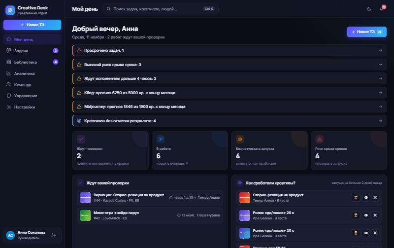
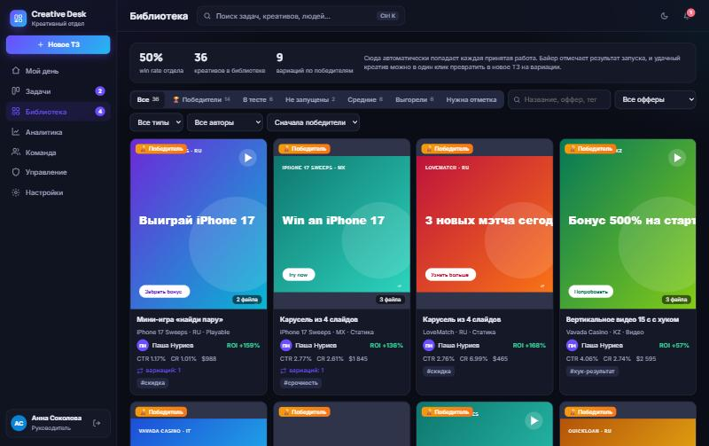
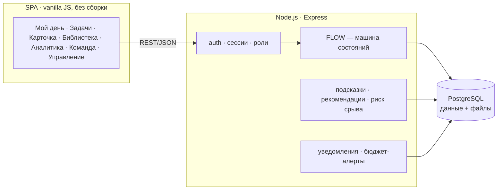
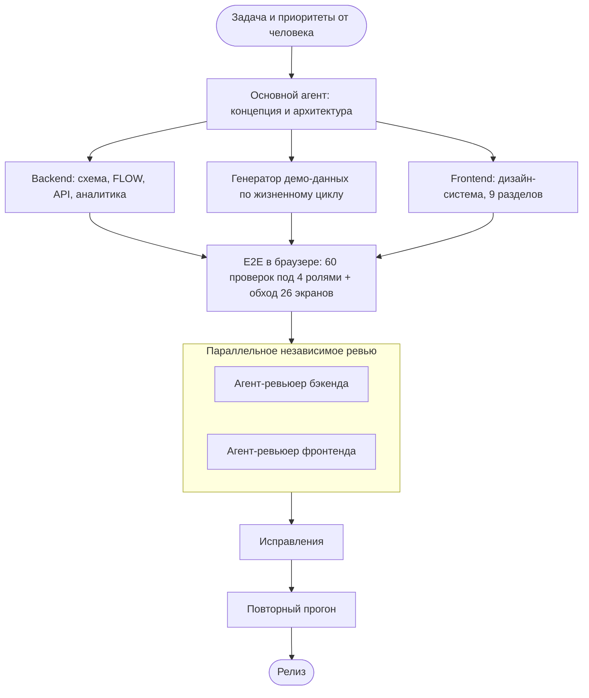

<div align="center">

# ✦ Creative Desk 2.0

**Рабочее пространство креативного отдела медиабаинга: от ТЗ до победившего креатива — в одном цикле.**

### 🚀 [Открыть демо](https://creative-desk-3m61.onrender.com) · 📐 [Концепция продукта](https://creative-desk-3m61.onrender.com/concept)

Демо-пароль у всех пользователей: `demo123`, на экране входа есть кнопки быстрого входа.
Бесплатный хостинг засыпает при простое, поэтому первое открытие может занять до минуты.

`Node.js 22` · `Express` · `PostgreSQL` · `Vanilla JS SPA` · `Docker` · `Render Blueprint`

</div>

---

<p align="center"> <br> </p>

## Главная идея

Обычный трекер заканчивается на статусе «Готово». В медиабаинге самое важное начинается после этого: **сработал ли креатив**. Creative Desk замыкает цикл:

```
ТЗ (из шаблона, с подсказками) → работа (таймер, AI-кредиты) → версии v1, v2… с правками по пунктам
  → принято → 📚 библиотека → 🏆 байер отмечает результат запуска → «Сделать вариации» → новое ТЗ
```

Из этого цикла собираются данные, которые помогают отделу:
- какие подходы и исполнители дают победителей;
- каких деталей чаще всего не хватает в ТЗ;
- сколько стоит один креатив и один победитель;
- побеждают ли вариации удачных креативов чаще новых идей.

## Что внутри

| Раздел | Что умеет |
|---|---|
| **Мой день** | У каждой роли свой стартовый экран. **Креативщик** видит свою очередь, свободные задачи по специализации и то, как сработали его креативы. **Байер** видит работы на проверку и креативы без отметки результата; результат можно отметить в один клик прямо с экрана. **Руководитель** видит алерты (просрочки, риск срыва, перегруз, прогноз AI-бюджета), загрузку команды и бюджеты. Каждый алерт кликабелен и ведёт к задачам, из которых он посчитан. |
| **Задачи** | Kanban с drag-and-drop, список с сортировкой и календарь дедлайнов. Фильтры хранятся в URL, поэтому любую выборку можно отправить ссылкой. Есть экспорт выборки в CSV/Excel. Если перенос карточки запрещён, система объясняет почему. Метка **«Риск срыва»** считается по фактической скорости отдела, а не по одному дедлайну. |
| **Новое ТЗ** | Шаблоны по типам креативов с чек-листами. Офферы и GEO выбираются из справочников. Дедлайн подставляется по SLA приоритета. Можно прикладывать файлы-референсы. Справа живая панель **«Подсказки отдела»**: реалистичный срок с учётом очереди, частые причины правок для этого типа (в один клик превращаются в пункт чек-листа), креативы, которые уже сработали по офферу (клик делает ТЗ их вариацией), и кто лучше справится. |
| **Карточка задачи** | Версии v1…vN с превью картинок и видео, сравнение двух версий рядом, правки по пунктам с причиной и отметкой выполнения. Таймер работы и учёт времени по этапам. **Себестоимость креатива**: AI-кредиты × цена плюс часы × ставка. Обсуждение с @упоминаниями, полная история, родословная (из какого победителя сделана вариация и сколько вариаций выросло из этого креатива). |
| **Библиотека** | Каждая принятая работа попадает сюда автоматически. Статус запуска: не запущен, в тесте, 🏆 победитель, средний, выгорел. Метрики: spend, CTR, CR, ROI. Фильтры, теги подходов и кнопка «Сделать вариации». |
| **Аналитика** | Пять вкладок. **Обзор**: KPI, статусы, динамика по дням, просрочки. **Люди**: загрузка, скорость, доля принятых с первого раза, win rate, часы, деньги. **Деньги и AI**: себестоимость задачи и победителя, бюджеты с прогнозом на конец месяца, матрица «исполнитель × сервис». **Качество**: причины правок с рекомендацией по шаблонам. **Результативность**: win rate по офферам, типам и людям; вариации против новых идей. Любая строка открывает задачи, из которых она посчитана. |
| **Команда** | Карточки сотрудников по реальным данным и тепловая карта дедлайнов на 2 недели вперёд: видно, кого не стоит нагружать. |
| **Управление** | Пользователи: создание с временным паролем, роли, специализации, ставки, отключение, сброс пароля. Справочники офферов и GEO. AI-сервисы с ценой кредита и месячным лимитом. Шаблоны ТЗ. SLA по приоритетам. |
| **Уведомления** | Хранятся на сервере и создаются по событиям: новое ТЗ по специализации, взяли / назначили, сдали версию, правки, приняли, @упоминание, отметка результата, 80% и 100% AI-бюджета. Какие типы получать, каждый настраивает сам. |
| **Везде** | `Ctrl K` открывает глобальный поиск по задачам, креативам, людям и командам; `N` создаёт новое ТЗ. Есть светлая и тёмная тема, 5 акцентных цветов, компактный режим и мобильная вёрстка. |

### Дизайн, который не тормозит

Стеклянный эффект используется только на трёх элементах: боковое меню, верхняя панель и шапка карточки. Всё остальное сплошное и дешёвое в отрисовке, длинные списки рендерятся лениво (`content-visibility`). На слабых компьютерах (≤ 4 ядер или ≤ 4 ГБ памяти) и при системной настройке «уменьшить движение» автоматически включается **облегчённый режим**: без размытия, анимаций и тяжёлых теней. Его можно включить вручную в настройках. Иконки сделаны на inline-SVG, без иконочных шрифтов и фреймворков.

## Демо-доступ

| Логин | Роль | Что посмотреть |
|---|---|---|
| `lead` | Руководитель | Алерты в «Моём дне», аналитика, управление, назначение исполнителя перетаскиванием |
| `buyer1`…`buyer3` | Медиабайеры | Создание ТЗ с подсказками, проверка версий, правки по пунктам, отметка результатов |
| `creative1`…`creative4` | Креативщики | Взять задачу, таймер, сдача версий с файлами и AI-расходами, @упоминания |

Демо-данные создаются при первом запуске. Это 48 задач за 30 дней, **прогнанные через реальный жизненный цикл**: назначения, версии со сгенерированными превью креативов, правки с причинами, комментарии, сессии таймера, AI-расходы и результаты запусков. У креативщиков разная скорость и разный win rate. Бюджеты откалиброваны так, что один сервис идёт к перерасходу, поэтому алерт видно сразу.

## Архитектура



- **Хранение.** В продакшене PostgreSQL (на Render создаётся автоматически из `render.yaml`). Файлы тоже лежат в базе (bytea): переживают перезапуски и не требуют отдельного S3. Локально запускается встроенный **PGlite**, то есть настоящий Postgres в WASM с тем же SQL: `npm start` работает без установки базы.
- **Машина состояний.** Все переходы описаны в объекте `FLOW` ([routes/tasks.js](routes/tasks.js)). Права проверяет сервер, а клиент лишь повторяет правила для подсказок в интерфейсе. Взятие задачи атомарно, поэтому двое не могут взять одну задачу одновременно.
- **Безопасность.** Пароли хешируются через scrypt, сравнение идёт за постоянное время. Сессии хранятся в httpOnly-cookie с TTL, вход ограничен по частоте. Загружаемые файлы проходят белый список типов, отдаются только авторизованным пользователям с `CSP sandbox` и `nosniff`. Весь SQL параметризован. В CSV-экспорте есть защита от формул. Весь пользовательский вывод экранируется, ссылки пропускаются только с протоколом http(s).
- **Модель данных:** `users`, `sessions`, `offers`, `geos`, `ai_services`, `templates`, `settings`, `tasks`, `versions`, `files`, `revision_items`, `comments`, `ai_costs`, `time_entries`, `library`, `notifications`, `history`.

```
server.js            — bootstrap, общие хелперы, права
db.js                — схема + адаптер pg / PGlite
seed.js              — генератор демо-данных по реальному жизненному циклу
routes/auth.js       — вход, профиль, настройки, справочники
routes/tasks.js      — задачи, переходы, версии, правки, комментарии, таймер, файлы, CSV
routes/library.js    — библиотека и результаты запусков
routes/insights.js   — «Мой день», подсказки ТЗ, рекомендации, аналитика, команда, уведомления, поиск
routes/admin.js      — пользователи, справочники, AI-сервисы, шаблоны, SLA
public/js/*.js       — SPA: core, tasks, taskcard, pages, analytics, admin
public/concept.html  — концепция продукта
```

## Запуск

```bash
npm install
npm start                # http://localhost:3000 — встроенный PGlite, демо-данные создаются сами
npm run reset            # удалить локальную базу (при остановленном сервере)
DATABASE_URL=postgres://… npm start   # внешний PostgreSQL
SEED_DEMO=0 npm start    # без демо-данных
```

**Render:** New → Blueprint → этот репозиторий. `render.yaml` создаст веб-сервис и бесплатную базу PostgreSQL и свяжет их. **Docker:** `docker build -t creative-desk . && docker run -p 3000:3000 creative-desk`.

---

## Как это сделано: AI-разработка

Проект сделан в **Claude Code** (Claude Opus 5.5) в режиме агентной разработки. Человек ставил задачи, принимал решения и проверял результат, AI-агенты проектировали, писали, тестировали и ревьюили код.



**Итерации проекта**
1. **v1**: базовый сервис по первому ТЗ, проверка в браузере, первое параллельное ревью двумя агентами (исправлены XSS, права, валидация).
2. **Концепция v2**: структура разделов, UX, приоритизированный список функций, план на 48 часов ([/concept](https://creative-desk-3m61.onrender.com/concept)).
3. **v2**: пересборка на PostgreSQL с хранением файлов. Новые разделы: «Мой день», библиотека, результативность, управление, команда. Добавлены подсказки при постановке ТЗ, рекомендации исполнителя, риск срыва, себестоимость, бюджеты, уведомления, поиск и новая дизайн-система.
4. **Проверка v2**: агент сам поднимал сервер во встроенном браузере. Он прошёл полный цикл задачи под всеми ролями и проверил более 30 негативных сценариев: чужая роль, чужая задача, недопустимые файлы, невалидные данные, отключённый доступ. Затем обошёл все 20 экранов и сделал скриншоты на десктопе и мобильном. Параллельно два независимых агента-ревьюера проверили бэкенд и фронтенд, их находки исправлены (см. ниже).

### Что нашло ревью v2 и что исправлено

Два агента-ревьюера независимо проверили код и нашли 20 проблем. Все исправлены, после чего полный набор проверок прогнан заново.

| Область | Что нашли | Как исправлено |
|---|---|---|
| 🔒 Гонки | Переходы статусов проверяли статус до транзакции: двойной клик по «На правки» мог задвоить правки, «вернуть в очередь» мог перебить сдачу версии, две параллельные сдачи давали одинаковый номер версии | Строка задачи блокируется (`SELECT … FOR UPDATE`), статус перепроверяется внутри транзакции, при конфликте возвращается 409. Добавлен `UNIQUE(task_id, n)` на версии |
| 🔒 Доступ | Байер, открывший чужой креатив в библиотеке, видел всё: ТЗ, комментарии, отклонённые версии, затраты и ставку креативщика | Для чужого креатива отдаётся урезанный вид: только принятая версия и результат запуска. Файлы прошлых версий закрыты. Ставка больше не уходит на клиент, клиент получает только итоговую стоимость работы |
| 🔒 Вход | Лимит попыток считался по общему IP за прокси, засчитывал успешные входы, а по времени ответа можно было подобрать существующие логины | `trust proxy`, лимит на пару «IP + логин» и только на неудачные попытки, хеширование выполняется всегда (с фиктивной солью), асинхронный `scrypt` |
| 🔒 XSS | Отдельные значения (GEO, логины, тексты рекомендаций, ссылки алертов) вставлялись в HTML без экранирования. Упоминания портили ссылки с `@` | Всё экранируется. Ссылки и упоминания разбираются раздельно |
| 📊 Деньги | Себестоимость задачи и цена победителя включали незавершённые задачи. Часы оценивались по ставке *текущего* исполнителя. Прогноз бюджета занижался в начале месяца | Считаются только принятые задачи. Часы оцениваются по ставке того, кто их отработал. Исправлены прогноз и границы месяца в UTC |
| 🛡 Надёжность | `/api/tasks/abc`, огромные ID, `1e999` в ставке, тысячи id в форме и экстремальные даты приводили к 500 | Строгая валидация ID, чисел и дат, ответ 400/404 |
| 🧭 Workflow | Расходы AI можно было дописать в уже принятую задачу. Удаление стирало креатив вместе с результатами из библиотеки. Отключённый сотрудник оставлял «вечный» таймер и висящие задачи | Расходы добавляются только в работе и на правках. Задачу из библиотеки удалить нельзя. При отключении сотрудника таймеры останавливаются, а задачи возвращаются в очередь |
| ♿ UX | Карточка открывалась с прокруткой к полю внизу. Вложенная кнопка ломала список «Свободные задачи». Фильтры сбрасывали фокус. Данные за открытой карточкой устаревали. Загрузку файлов нельзя было выбрать с клавиатуры | Фокус ставится на кнопку закрытия, разметка исправлена, фокус восстанавливается, страница обновляется при закрытии карточки, зона загрузки доступна с клавиатуры |

**Найдено и исправлено при собственном прогоне:**
- сдача версии без AI-расходов отклонялась;
- в демо-данных время работы иногда уходило в минус;
- статика кэшировалась на час, из-за чего после деплоя у пользователя оставался старый код.

**Итог:** 60 проверок проходят.
- 36 базовых: полный цикл задачи под всеми ролями плюс негативные сценарии.
- 24 дополнительных: гонки, доступы, валидация, лимит входа.
- Обход 26 экранов под тремя ролями без ошибок.
- Сквозные сценарии через интерфейс: взять задачу → таймер → сдать → правки → вариация из библиотеки → назначение перетаскиванием.

### Инструменты

| Инструмент | Для чего |
|---|---|
| **Claude Code** · Claude Opus 5.5 | Основной агент: концепция, архитектура, код, интеграция, исправления |
| **Claude-субагенты** (параллельно) | Независимое ревью бэкенда и фронтенда на каждой итерации |
| **Встроенный браузер Claude** | E2E-сценарии под ролями, обход экранов, скриншоты, проверка адаптивности |
| **GitHub CLI**, **Render Blueprint** | Публикация и инфраструктура как код |
